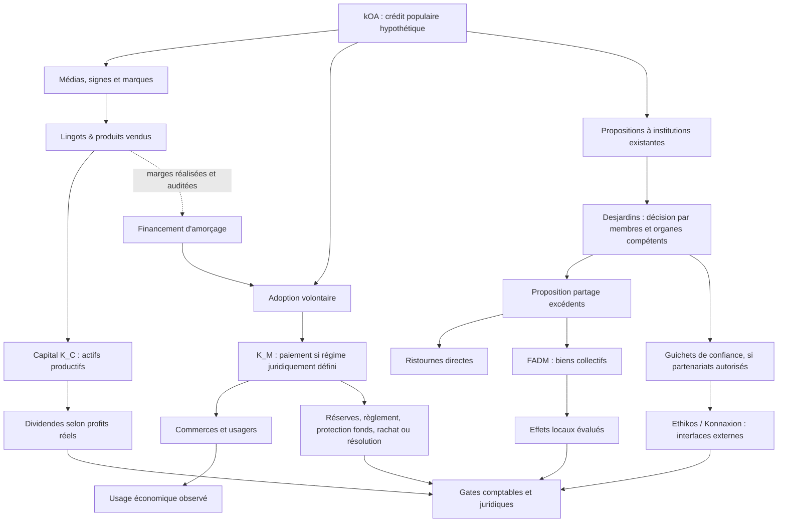

# Graphe de la transition (vue textuelle)

Le graphe structuré `canon/domain/multiangle/graph.json` contient les liens de provenance S/P/W/D/G et est validé pour l'absence d'IDs manquants; il ne simule pas la causalité économique.
